<p align="center">
  <a href="https://kashi.sepantapouya.com">
    <picture>
      <source media="(prefers-color-scheme: dark)" srcset=".github/assets/hero-dark.svg">
      <source media="(prefers-color-scheme: light)" srcset=".github/assets/hero-light.svg">
      
    </picture>
  </a>
</p>

<h1 align="center">کاشی · Kashi</h1>

<p align="center">
  <a href="https://kashi.sepantapouya.com"><b>مستندات و نمونه‌ها</b></a> ·
  <a href="https://kashi.sepantapouya.com/docs/figma/">فیگما</a> ·
  <a href="https://kashi.sepantapouya.com/docs/ai/">هوش مصنوعی (MCP)</a> ·
  <a href="https://github.com/Sepantapouya/Kashi/releases">نسخه‌ها</a> ·
  <a href="https://t.me/kashidesign">کانال تلگرام</a>
</p>

<p align="center">
  <a href="https://github.com/Sepantapouya/Kashi/actions/workflows/ci.yml"></a>
  <a href="https://www.npmjs.com/package/@kashi-ui/react"></a>
  <a href="https://www.npmjs.com/package/@kashi-ui/react"></a>
  <a href="https://github.com/Sepantapouya/Kashi/stargazers"></a>
  <a href="LICENSE"></a>
  <a href="https://t.me/kashidesign"></a>
</p>

دیزاین‌سیستم فارسی و متن‌باز — **RTL-first**، **Dark-first**، **دسترس‌پذیر** و **کاملاً قابل‌سفارشی‌سازی**، برای React و هر فریم‌ورک دیگری. با الهام از Untitled UI.

> **In English —** Kashi is an open-source design system for Persian (right-to-left) products: React components, framework-free Web Components, pure-CSS styles, design tokens, a Tailwind preset, 15,000 icons, a Figma kit generated from the code and an MCP server for AI assistants. It ships Persian-specific fields (Jalali date picker, national ID, bank card with bank logos, IBAN, licence plate) and targets WCAG 2.2 AA. Every built-in string also has an English locale: `<KashiProvider locale="en">`. Quick start: `npm i @kashi-ui/react @kashi-ui/css` · [docs](https://kashi.sepantapouya.com) · [releases](https://github.com/Sepantapouya/Kashi/releases).

## پکیج‌ها

همهٔ پکیج‌ها با یک نسخهٔ یکسان منتشر می‌شوند؛ تغییرات هر نسخه در [Releases](https://github.com/Sepantapouya/Kashi/releases).

| پکیج | نسخه | دانلود ماهانه | کاربرد |
|---|---|---|---|
| [`@kashi-ui/tokens`](https://www.npmjs.com/package/@kashi-ui/tokens) | [](https://www.npmjs.com/package/@kashi-ui/tokens) |  | رنگ، فاصله، فونت و… به شکل CSS Variables، JSON، JS و DTCG (فیگما و Style Dictionary) |
| [`@kashi-ui/css`](https://www.npmjs.com/package/@kashi-ui/css) | [](https://www.npmjs.com/package/@kashi-ui/css) |  | استایل کامپوننت‌ها با CSS خالص — برای هر فریم‌ورکی |
| [`@kashi-ui/react`](https://www.npmjs.com/package/@kashi-ui/react) | [](https://www.npmjs.com/package/@kashi-ui/react) |  | کامپوننت‌های React |
| [`@kashi-ui/elements`](https://www.npmjs.com/package/@kashi-ui/elements) | [](https://www.npmjs.com/package/@kashi-ui/elements) |  | وب کامپوننت‌ها برای Vue، Svelte، Angular، وردپرس و HTML: فیلدهای فارسی، تقویم شمسی، فرم نشانی، نقشهٔ ایران، جدول داده، Combobox، منو، پنجره و اعلان |
| [`@kashi-ui/persian`](https://www.npmjs.com/package/@kashi-ui/persian) | [](https://www.npmjs.com/package/@kashi-ui/persian) |  | تاریخ شمسی، ارقام فارسی، اعتبارسنجی کد ملی و کارت؛ بدون وابستگی |
| [`@kashi-ui/icons`](https://www.npmjs.com/package/@kashi-ui/icons) | [](https://www.npmjs.com/package/@kashi-ui/icons) |  | ۱۵٬۰۰۰ آیکون کاشی در شش سبک؛ React، SVG و اسپرایت |
| [`@kashi-ui/bank-logos`](https://www.npmjs.com/package/@kashi-ui/bank-logos) | [](https://www.npmjs.com/package/@kashi-ui/bank-logos) |  | لوگوی SVG ۴۰ بانک و ۱۰ درگاه پرداخت ایران (CC0) |
| [`@kashi-ui/tailwind`](https://www.npmjs.com/package/@kashi-ui/tailwind) | [](https://www.npmjs.com/package/@kashi-ui/tailwind) |  | پریست Tailwind 3 و 4: توکن‌های کاشی به‌شکل کلاس‌های Tailwind، همگام با تم |
| [`@kashi-ui/mcp`](https://www.npmjs.com/package/@kashi-ui/mcp) | [](https://www.npmjs.com/package/@kashi-ui/mcp) |  | سرور MCP برای Claude، Cursor و دیگر دستیارهای هوش مصنوعی |
| [`@kashi-ui/codemod`](https://www.npmjs.com/package/@kashi-ui/codemod) | [](https://www.npmjs.com/package/@kashi-ui/codemod) |  | مهاجرت خودکار: کد منسوخ را پیش از حذف با جایگزینش عوض می‌کند |

## پایدار برای محصولات سازمانی (۱.۰)

- **دوزبانه:** با `<KashiProvider locale="en">` (یا `setLocale("en")` در وب کامپوننت‌ها) همهٔ متن‌های داخلی، ارقام و نام ماه‌ها انگلیسی می‌شوند. [راهنما](https://kashi.sepantapouya.com/docs/i18n/)
- **[سیاست تغییرات](https://kashi.sepantapouya.com/docs/versioning/):** SemVer، منسوخ کردن پیش از حذف و راهنمای مهاجرت برای هر نسخهٔ اصلی.
- **[امنیت](SECURITY.md):** گزارش خصوصی آسیب‌پذیری با زمان پاسخ مشخص.
- **[سقف حجم](https://kashi.sepantapouya.com/docs/sizes/):** هر کامپوننت سقف حجم دارد و تست نمی‌گذارد بی‌اجازه بزرگ‌تر شود.
- **تست تصویری:** از همهٔ نمونه‌ها در تم روشن و تیره عکس گرفته و با عکس مرجع مقایسه می‌شود (`npm run test:visual`).

## کامپوننت‌ها

Button · Input · Textarea · Select · Checkbox · RadioGroup · Switch · Badge · Card · Alert · Avatar · AvatarGroup · Tabs · Dialog · Toast · Tooltip · DropdownMenu · DataTable · Pagination · Breadcrumb · Accordion · Stepper · Progress · Spinner · Skeleton · EmptyState · Divider · Kbd · RelativeTime · Combobox · MultiSelect · CommandPalette · TagInput · FileUpload · Slider · NumberInput · Popover · StatCard · Timeline · SideNav · SegmentedControl · CopyButton · Banner · Rating · TreeView · ButtonGroup · ChipGroup · PasswordStrength · BarChart · LineChart · ContextMenu · InlineEdit · PieChart · BarList · ProportionBar · Sparkline · Carousel · ColorPicker · Tour · Meter · Splitter

**فارسی:** DatePicker و Calendar شمسی · DateRangePicker (بازهٔ تاریخ شمسی) · TimeInput (ساعت) · PostalCodeInput (کد پستی) · PlateInput (پلاک خودرو) · LandlineInput (تلفن ثابت) · MonthPicker (ماه شمسی) · Countdown (شمارش معکوس) · ActivityHeatmap (نقشهٔ فعالیت شمسی) · ProvinceSelect (استان) · NationalIdInput (کد ملی) · CardNumberInput (شماره کارت با لوگوی بانک) · IbanInput (شبا) · MobileInput (موبایل) · PriceInput (مبلغ به حروف) · OtpInput (کد تأیید) · ابزارهای `@kashi-ui/persian`

## نصب

```bash
npm install @kashi-ui/react @kashi-ui/css
```

```tsx
import "@kashi-ui/css";
import { Button } from "@kashi-ui/react";

<Button variant="primary">ثبت‌نام</Button>
```

بدون React (HTML، Vue، Svelte، Angular، وردپرس) با وب کامپوننت‌ها:

```html
<link rel="stylesheet" href="https://cdn.jsdelivr.net/npm/@kashi-ui/css/dist/kashi.css">
<script type="module" src="https://cdn.jsdelivr.net/npm/@kashi-ui/elements/dist/cdn/kashi-elements.js"></script>

<button class="k-btn k-btn--primary">ثبت‌نام</button>
<kashi-national-id name="national_id" required></kashi-national-id>
<kashi-date-picker label="تاریخ تولد" name="birth"></kashi-date-picker>
```

راهنما: [kashi.sepantapouya.com/docs/web-components](https://kashi.sepantapouya.com/docs/web-components/)

## Tailwind

```bash
npm i @kashi-ui/tailwind
```

```css
@import "@kashi-ui/tailwind"; /* اول بیاید تا کلاس‌های Tailwind بر کامپوننت‌ها برنده باشند */
@import "tailwindcss";
@import "@kashi-ui/css";
```

حالا `bg-brand`، `text-secondary`، `border-brand`، `rounded-lg` و `shadow-md` همان توکن‌های کاشی‌اند و با تم تیره و روشن و `createTheme` عوض می‌شوند. راهنما و Tailwind 3: [kashi.sepantapouya.com/docs/tailwind](https://kashi.sepantapouya.com/docs/tailwind/)

## استفاده با هوش مصنوعی

سرور MCP کاشی دستیارهای هوش مصنوعی را به مستندات، آیکون‌ها، توکن‌ها و ابزارهای فارسی کاشی وصل می‌کند:

```bash
claude mcp add kashi -- npx -y @kashi-ui/mcp
```

تنظیمات Cursor، VS Code و بقیه: [kashi.sepantapouya.com/docs/ai](https://kashi.sepantapouya.com/docs/ai/) · کل مستندات برای مدل‌های زبانی: [llms-full.txt](https://kashi.sepantapouya.com/llms-full.txt)

## فیگما

پلاگین **Kashi UI Kit** کل دیزاین‌سیستم را از روی همین کد در فیگما می‌سازد:
- حدود ۲۷۰ Variable با تم تیره/روشن، گردی، تراکم، فونت و سایه؛ بدون Style
- بیش از ۷۰ کامپوننت با حدود ۷۰۰ variant، هر کدام در یک صفحه، شامل کامپوننت‌های فارسی و لوگوی همهٔ بانک‌ها
- به‌روزرسانی درجا با هر نسخهٔ جدید

دانلود و راهنما: [kashi.sepantapouya.com/docs/figma](https://kashi.sepantapouya.com/docs/figma/)

## توسعه

```bash
npm install
npm run build
npm test      # همهٔ تست‌ها، تست دوزبانه و سقف حجم (npm run size)
npm run docs:build && npm run test:visual   # تست تصویری؛ عکس مرجع تازه: npm run test:visual:update
npm run dev   # پیش‌نمایش در http://localhost:4321/playground/
npm run docs  # سایت مستندات در http://localhost:4400 (Node 24، طبق .nvmrc)
```

## سفارشی‌سازی

```js
import { createTheme } from "@kashi-ui/tokens";
// یک رنگ برند → کل طیف رنگی ساخته می‌شود
const css = createTheme({ brand: "#7c3aed", radius: 1.5, density: 0.875 });
```

یا مستقیم با CSS (همهٔ استایل‌های کاشی در Cascade Layer هستند، پس CSS شما همیشه برنده است):

```css
:root {
  --k-brand-500: #7c3aed;
  --k-radius-factor: 0;     /* گوشه‌های تیز */
  --k-btn-font-weight: 500;
}
```

## دسترس‌پذیری

هدف WCAG 2.2 AA است. کنتراست همهٔ جفت‌رنگ‌ها در هر بیلد خودکار بررسی می‌شود و حالت کنتراست بالا (`prefers-contrast: more` یا `data-contrast="more"`) متن AAA دارد. در هر تغییر، axe همهٔ نمونه‌ها را در تم روشن، تیره و کنتراست بالا بررسی می‌کند و تست‌های صفحه‌کلید فوکوس پنجره‌ها و ناوبری فهرست‌ها را می‌آزمایند. فوکوس کیبورد، صفحه‌خوان، `forced-colors` و `prefers-reduced-motion` هم پشتیبانی می‌شوند.

## مشارکت

مخزن: [github.com/Sepantapouya/Kashi](https://github.com/Sepantapouya/Kashi)

<!-- آمار زنده: ستاره از GitHub، کلون‌ها از stats.json که GitHub Action در شاخهٔ stats می‌نویسد (گیت‌هاب کلون را روزانه حساب می‌کند) -->
[](https://kashi.sepantapouya.com/#community-title)
[](https://kashi.sepantapouya.com/#community-title)

کانال تلگرام کاشی برای خبر نسخه‌ها، کامپوننت‌های تازه و نکته‌های طراحی فارسی: [t.me/kashidesign](https://t.me/kashidesign)

کاشی متن‌باز است (MIT). راهنما: [CONTRIBUTING.md](CONTRIBUTING.md)
ریسرچ و نقشهٔ راه: [docs/RESEARCH.md](docs/RESEARCH.md) · انتشار نسخه: [RELEASING.md](RELEASING.md)

ساخته‌شده توسط [سپنتا پویا](https://sepantapouya.com).

فونت وزیرمتن اثر صابر راستی‌کردار است و تحت لایسنس SIL OFL 1.1 توزیع می‌شود.
