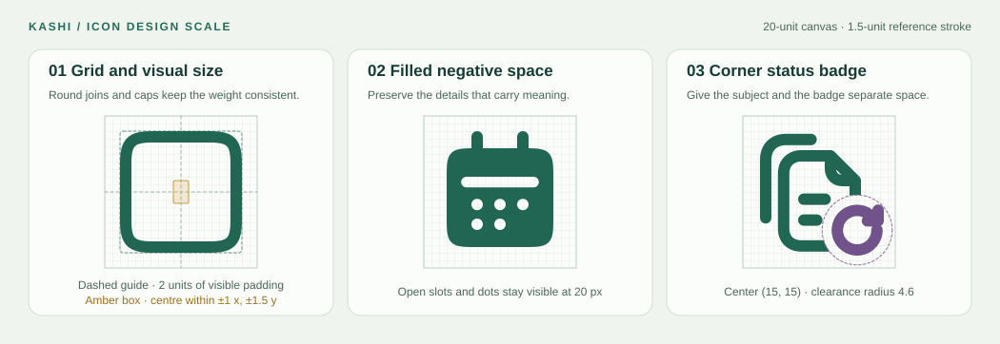

# اسکیل طراحی آیکون‌های کاشی

استاندارد طراحی و بازبینی آیکون‌های رابط کاربری کاشی، از انتخاب مفهوم تا خروجی SVG، React و فیگما. **طرح مرجع روی شبکهٔ ۲۰×۲۰ و با خط ۱٫۵ واحدی ساخته می‌شود.** معیار نهایی خوانایی، نمونهٔ واقعی ۲۰ پیکسلی کنار آیکون‌های هم‌خانواده است.



## ۱. انتخاب مفهوم

1. کاربرد را در یک عبارت روشن بنویس، مثل «بازیابی نسخهٔ قبلی فایل». اسم شیء، عمل و وضعیت را مشخص کن.
2. عنوان فارسی، نام انگلیسی، هم‌معنی‌ها و شکل‌های نزدیک را در [منبع آیکون‌ها](./src/icons.js) و کاتالوگ بررسی کن. وقتی آیکون موجود همان کار را انجام می‌دهد، از آن استفاده کن.
3. برای مفهوم مستقل، طرح پایه بساز. برای یک حالت یا عمل روی همان مفهوم، شکل اصلی را حفظ کن و یک نشان مرتبط اضافه کن. یک تغییر رنگ، ضخامت یا موقعیت به‌تنهایی مفهوم تازه نمی‌سازد.
4. در مجموعه‌های بزرگ، طرح‌های پایه و حالت‌های ترکیبی را جدا بشمار. کاربردهای پرتکرار و حالت‌هایی را انتخاب کن که در رابط واقعاً به هم نیاز دارند.

## ۲. شبکه و اندازهٔ بصری

مقادیر جدول **واحد SVG** در `viewBox="0 0 20 20"` هستند. مختصات ۲٫۷۵ و ۱۷٫۲۵ به مرکز خط اشاره می‌کنند. در ضخامت ۱٫۵، لبهٔ بیرونی همان خط به ۲ و ۱۸ می‌رسد.

| ویژگی | مقدار مرجع | نحوهٔ استفاده |
| --- | --- | --- |
| بوم | ۲۰×۲۰ | مرکز هندسی `(10, 10)` |
| محدودهٔ معمول مرکز خط | `2.75 … 17.25` | حدود ۱۴٫۵ واحد برای ضلع غالب شکل |
| حاشیهٔ مرئی | حدود ۲ واحد در هر طرف | پس از احتساب ضخامت، نوک‌ها و نشان گوشه بررسی شود |
| خط اصلی | ۱٫۵ | سر و اتصال خط گرد، با وزن یکسان در یک خانواده |
| جزئیات ریز | ۱٫۱ تا ۱٫۳، در صورت نیاز | برای نقطه، شیار یا جزئیاتی که با خط اصلی ادغام می‌شوند |
| فاصلهٔ بین دو جزئیات مستقل | هدف ۱ تا ۱٫۲۵ فضای خالی | در ضخامت ۲، دست‌کم نیم واحد فاصلهٔ مرئی برای اجزای معنی‌دار |
| گوشهٔ قاب | معمولاً ۲٫۲۵ تا ۳٫۷۵ | برای قاب، از تابع `sq()` یا هندسهٔ هم‌خانواده استفاده کن |

- ابتدا یک اندازهٔ نزدیک به آیکون‌های هم‌خانواده انتخاب کن. شکل کشیده را با ضلع غالب و فضای خالی اطرافش مقایسه کن. برای دایره، مثلث و شکل‌های سبک می‌توان از اندکی بزرگ‌نمایی بصری استفاده کرد، به شرط حفظ حاشیهٔ مرئی.
- تعادل را با خودِ نقش بسنج، شامل دسته، نوک، پایه و نشان گوشه. از `shift()` برای اصلاح جابه‌جایی کوچک استفاده کن. برای تغییر اندازهٔ شکل، هندسه را تنظیم کن و وزن خط را دوباره بررسی کن.
- کنار یک ردیف آیکون مرجع در اندازهٔ واقعی نگاه کن. یک قاب پرجزئیات ممکن است از یک شکل ساده با همان اندازه سنگین‌تر دیده شود. ابتدا جزئیات کم‌ارزش را کم کن، سپس وزن و اندازه را تنظیم کن.
- فضای منفی را از **لبهٔ مرئی تا لبهٔ مرئی** بسنج. برای مثال، دو خط ۱٫۵ واحدی که محورهایشان ۲٫۵ واحد فاصله دارد، ۱ واحد فاصلهٔ خالی دارند.

## ۳. شکل خطی و توپر

طرح `light` نقطهٔ شروع است. دور قاب و شکل اصلی را با مسیر بسته، و دسته، ساقه و خطوط داخلی را با مسیر باز مشخص کن. هر جزئیات باید در تشخیص مفهوم یا ارتباط اجزا نقش داشته باشد. از `currentColor`، سر گرد و اتصال گرد استفاده کن.

| سبک | تصمیم طراحی |
| --- | --- |
| `light` · خطی | شکل و جزئیات اصلی با خط ۱٫۵ واحدی و فضای خالی کافی خوانده شوند. |
| `bold` · توپر | بدنهٔ اصلی را پر کن. جزئیات معنی‌دار را با برش شفاف یا فاصلهٔ واقعی حفظ کن. خط‌های باز می‌توانند کمی پررنگ‌تر باشند. |
| `bulk` · حجمی | سطح اصلی و جزئیات خطی با اختلاف کدری از هم جدا باشند. |
| `two-tone` · دورنگ | رابطهٔ بخش اصلی و فرعی با اختلاف کدری خوانده شود. |
| `broken` · شکسته | شکست خط در بخشی قرار بگیرد که تشخیص شکل را از بین نبرد. |
| `curved` · منحنی | گردی قاب نرم‌تر باشد و فضای داخل قاب همچنان کافی بماند. |

اگر نسخهٔ خودکار توپر معنا یا فضای خالی مهم را از دست می‌دهد، برای همان آیکون با `withBold()` نسخهٔ دستی طراحی کن. حلقهٔ ذره‌بین، مردمک و مرکز چرخ‌ها نمونه‌هایی از فضای خالی معنی‌دارند. برای دایره‌ای که فقط باید به شکل حلقه بماند، نشان `data-outline="true"` در منبع قابل استفاده است. در طرحی مثل کپی یا ویدیو، فاصلهٔ دو جزء باید پس از توپر شدن هم دیده شود. برای مقایسه، قالب خطی و توپر را در یک رنگ و اندازه کنار هم بگذار.

## ۴. اسکیل نشانِ وضعیت

- جای مرجع نشان گوشهٔ پایین راست، حوالی `(15, 15)` است. قطر یا پهنای مرئی معمول نشان حدود **۵ تا ۷ واحد** است. ساعت و قفل به فضای داخلی و تیک و ضربدر به فاصله از لبهٔ شکل نیاز دارند.
- برای حالت‌های ترکیبی از قرارداد `data-cut` و نشان‌های مشترک کاتالوگ استفاده کن. شعاع **۴٫۶ واحد** نقطهٔ شروع ماسک مرجع است. فاصلهٔ شفاف دور نشان را در خروجی واقعی بررسی کن.
- یک حالت را با **یک نشان** منتقل کن. اگر طرح پایه خودش ساعت، فلش بازگشت یا علامت هشدار دارد، در حالت ترکیبی از نسخه‌ای از شکل اصلی استفاده کن که آن نشان را کنار می‌گذارد. کوچک کردن هر دو نشان مشکل را حل نمی‌کند.
- مثال نسخه‌های فایل، دو برگه هویت پایه‌اند. ساعت برای «تاریخچه»، فلش چرخشی برای «بازیابی» و فلش پایین برای «دانلود» به‌کار می‌روند. در بازیابی و دانلود، دو برگه و نشان همان عمل باید باقی بمانند.
- اگر ماسک تشخیص شکل اصلی را سخت کرد، اول طرح پایه یا جای جزئیات داخلی را اصلاح کن. سپس جای نشان یا شعاع ماسک را تنظیم کن. در اندازهٔ ۱۶ پیکسل، نشان را کنار نمونهٔ پایه بررسی کن.

## ۵. نام‌گذاری و تحویل

- کلید انگلیسی ثابت و به‌صورت `kebab-case` باشد، مثل `file-version-restore`. عنوان فارسی کاربرد را روشن بیان کند. واژه‌های جست‌وجو شامل عبارت‌های رایج فارسی و انگلیسی باشند.
- از دستهٔ موجود و نزدیک به کاربرد آیکون استفاده کن. پرچم `directional` برای جهت معنایی رابط است، مثل «بعدی» و «قبلی». شکل‌های مربوط به جهت فیزیکی را با همان جهت طراحی کن.
- منبع طرح [`src/icons.js`](./src/icons.js) و موتور سبک‌ها [`src/render.js`](./src/render.js) است. SVGها، اسپرایت، کامپوننت‌های React و خروجی فیگما را از منبع بساز. برای آیکون تزئینی از خروجی پیش‌فرض و برای آیکون مستقلِ معنادار از عنوان دسترس‌پذیر استفاده کن.
- برای تغییر یک آیکون موجود، نمونهٔ قبل و بعد را کنار هم در اندازهٔ یکسان ارائه کن. برای مجموعهٔ تازه، نمونهٔ واقعی و نمای بزرگ‌تر را با نام آیکون نشان بده.

## ۶. بررسی پیش از تحویل

- [ ] مفهوم، نام و طرح با کاتالوگ مقایسه شده و کاربردش روشن است.
- [ ] خروجی در **۱۶، ۲۰ و ۲۴ پیکسل** روی زمینهٔ روشن و تیره بررسی شده است. برای عیب‌یابی می‌توان نمای ۴۰ تا ۶۰ پیکسلی هم دید.
- [ ] مرکز بصری، وزن و حاشیه با چند آیکون هم‌خانواده مقایسه شده‌اند. در ضخامت پیش‌فرض ۱٫۵ و حالت ضخیم‌تر ۲، اجزای اصلی بریده یا ادغام نمی‌شوند.
- [ ] نسخهٔ توپر در اندازهٔ واقعی بازبینی شده و شش سبک در خروجی SVG بررسی شده‌اند. در حالت ترکیبی، نشان مرتبط از شکل پایه جدا دیده می‌شود.
- [ ] تعداد آیکون‌ها، قابلیت جست‌وجوی فارسی و انگلیسی و نمایش نمونه در فیگما بررسی شده‌اند.

```sh
npm run build -w @kashi-ui/icons
npm test -w @kashi-ui/icons
npm run figma:test
```

آزمون‌ها ساخت خروجی و قراردادهای مشترک را بررسی می‌کنند. پیش‌نمایش اندازهٔ واقعی برای تصمیم‌های بصری لازم است.
